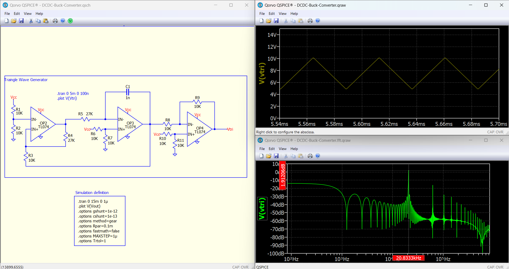
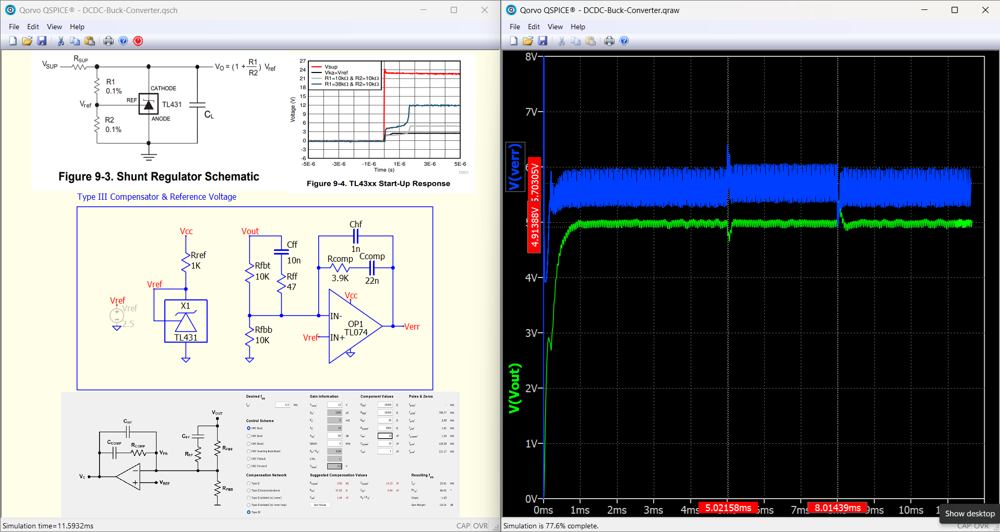
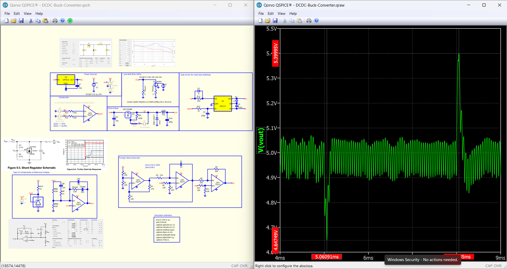
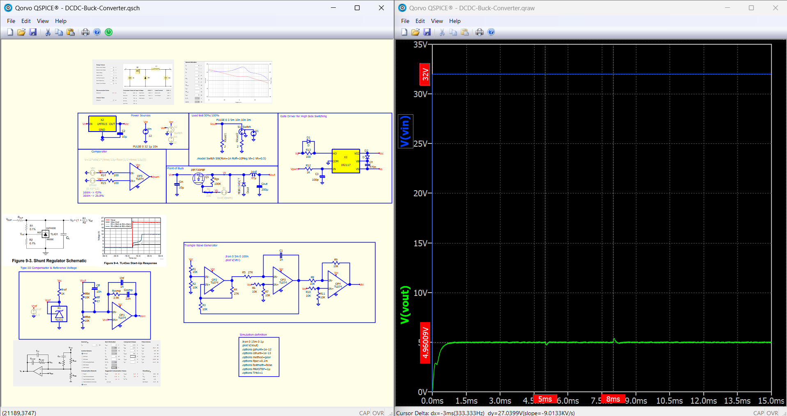

# DCDC-Buck-Converter

Qspice simulation of a DC-DC Buck Converter (32V to 5V @ 5A max) using analog eletronics.

## Triangle Wave Oscilattor

Frequency in 20kHz. Capacitor C1 and R5 sets the frequency. Last stage is only for amplificate. 

## Compensator Type III

From Power Stage Designer (Texas Instruments), using TL074 as compensator and TL431 as voltage reference.

## Complete Circuit

Undershoot of 4.65V (0.35V - 7% of 5V), overshoot of 5.4V (0.4V - 8% of 5V), and 0.2ms for stabilization of step load response (2.5A@0ms->5A@5ms->2.5A@8ms).

32V source is a PULSE source that starts in 1us. The circuit takes 1ms to get 5V converted on Vout.

